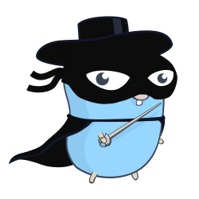

# gallant

Gallant is a customizable linter built to utilize Decision Models (i.e. Jev, Clef, and other system one models) to lint your code, documents, and any other text-based files.

## Why Gallant?

Some rules that would be great to express as lints in a codebase are very hard to perform in traditional deterministic systems -- "Does the comments in this file repeat what the code already says". As such, these type of checks are left either to human reviewers in PRs or to expensive and slow LLM models. 

Decision Models are fast, cheap(er), and can work on more fuzzy rules that traditional software has not been able to. Gallant is a solution to provide a simple to use cli program with no runtime requirements and minimal dependencies. 

#### Why not X other Decision Model linter?

I looked at the other available tools doing this type of work, and I was not left impressed. All the tools I saw were immense slop dumps, required runtimes like python/npm, servers you had to continually run, terrible CLIs, or had many many dependencies (aka supply chain attack vectors!)

I build Gallant to (try) and avoid all of those things. Gallant requires no runtime as it is in go. The CLI adheres to standard unix utility principles such as working off files/filepaths, minimizing configuration needed, and doing one thing well. 

Please, if you find it useful give it a share in your favorite tech community!

## Installation

Releases are available to install on the [Releases](https://github.com/madxmike/gallant/releases/) page. 

#### Build From Source

Install the latest release with Go:

```sh
go install github.com/madxmike/gallant/cmd/gallant@latest
```

To install a specific release, pin its version:

```sh
go install github.com/madxmike/gallant/cmd/gallant@v0.1.0
```

## Usage

To use gallant you will need a set of files and rules. By default gallant will look in the relative `.agents/gallant` for rules. You can then run `gallant .` to apply the rules to all files in the relative path. For more information see `gallant --help`

For information on making Rules see `gallant --help rules`

For information on available providers see `gallant --help providers`

## Limitations

Decision models as of writing (10/10/2026) have relatively small input context windows (orders of a couple hundred to a couple thousand tokens). Some hosted models have larger contexts, but you should expect rejections if the file you are linting is too large. 

If you are facing this you may chunk the file yourself into relevant, smaller, pieces. Gallant does not do this itself, but you can pass arbitrary input from stdin (See Usage above). 

These models are only now becoming mainstream, but are seeing rapid development. The hope is that new models will allow bigger inputs soon enough (as we saw with LLMs). 

## Contributing

Well thought out and made contributions are welcome.

#### Adding New Providers

Gallant is not intended to encompass every possible decision model provider. If the provider is large, widely used, or a popular local servers then they will be considered. 

#### Recording Examples

The examples ship terminal recordings generated with
[VHS](https://github.com/charmbracelet/vhs). Re-recording them requires VHS to
be installed:

```sh
OPENCODE_API_KEY=... vhs examples/ste100/.vhs/demo.tape
```

## Privacy

Gallant does not emit telemetry, log, or attempt to obtain any additional information than what you provide as input. As gallant interfaces with hosted providers of your chosing it will pass information you give to these providers in order to perform lint evalautations. See your chosen provider's privacy policy. 

## License

MIT. See [LICENSE](LICENSE).

## Credits

The gopher logo used in this project is from [egonelbre/gophers](https://github.com/egonelbre/gophers).

The Go gopher was designed by Renee French. Read http://blog.golang.org/gopher for more details.
