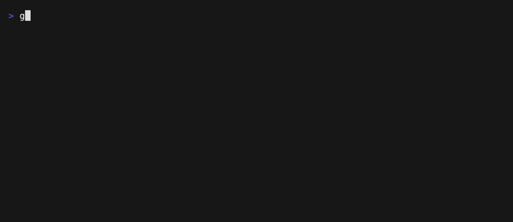

# Go review

Reviews a Go file on two dimensions, one rule per decision type.

- `rules/comments.md` (choice) — classifies the file's comments.
- `rules/readability.md` (score) — rates how hard the file is to read.
- `testdata/sample.go` — the file being reviewed.



Set an API key, then run from the repository root:

```sh
export OPENCODE_API_KEY=...
gallant --provider opencode --model jev-1.13-free \
  --rules examples/go-review/rules examples/go-review/testdata/sample.go
```

The file is evaluated by a model, so the API key is required.

Re-record the demo GIF with [VHS](https://github.com/charmbracelet/vhs):

```sh
OPENCODE_API_KEY=... vhs examples/go-review/.vhs/demo.tape
```
