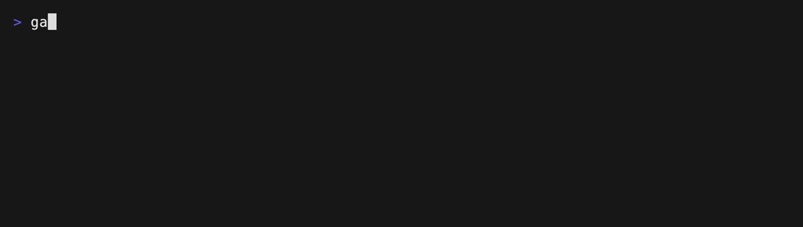

# Over-extraction

Catches a pure core taken too far: a file that wraps every trivial check in its
own one-expression function. This uses a **noul** rule.



- `rules/trivial-helpers.md` — the rule.
- `sample/sample.go` — one-expression helpers such as `isEmpty`, `isPositive`,
  and `hasTags`.
- `clean/clean.go` — the same checks inline, with only `totalPrice` (real logic)
  extracted.

Set an API key, then run from the repository root:

```sh
export OPENCODE_API_KEY=...
gallant --provider opencode --model jev-1.13 \
  --rules examples/over-extraction/rules examples/over-extraction
```

`sample/sample.go` clears the rule's 0.7 threshold, so the directory run reports
it:

```
examples/over-extraction/sample/sample.go trivial-helpers.md noul 91% fail
examples/over-extraction/sample/sample.go trivial-helpers.md noul 9% pass
```

`clean/clean.go` stays under the threshold, so the same run says nothing about
it. Ask for passing findings to see why:

```sh
gallant --provider opencode --model jev-1.13 --include-passing \
  --rules examples/over-extraction/rules examples/over-extraction/clean
```

```
examples/over-extraction/clean/clean.go trivial-helpers.md noul 20% fail
examples/over-extraction/clean/clean.go trivial-helpers.md noul 80% pass
```

The rule names the shape it rejects (one trivial expression: nil test, length
test, comparison, field read) and the carve-outs (multi-step, domain concept,
reused definition), so the model does not flag every small function. Lower
`minConfidence` to hear about borderline files, or raise it to report only the
clear cases.

The file is evaluated by a model, so the API key is required.

Re-record the demo GIF with [VHS](https://github.com/charmbracelet/vhs):

```sh
OPENCODE_API_KEY=... vhs examples/over-extraction/.vhs/demo.tape
```
