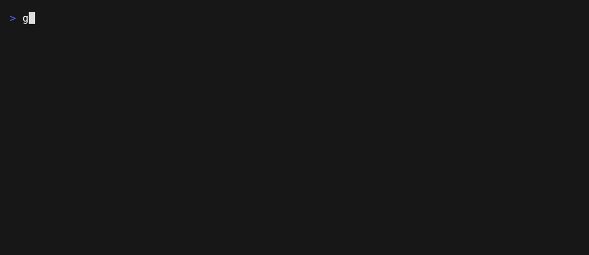

# Readability

Rates how hard a Go file is to read. This uses a **score** rule, and reports a
violation unless the file is easy to read.



- `rules/readability.md` — the rule.
- `sample.go` — the file being reviewed.

Set an API key, then run from the repository root:

```sh
export OPENCODE_API_KEY=...
gallant --provider opencode --model jev-1.13-free \
  --rules examples/readability/rules examples/readability/sample.go
```

The file is evaluated by a model, so the API key is required.

Re-record the demo GIF with [VHS](https://github.com/charmbracelet/vhs):

```sh
OPENCODE_API_KEY=... vhs examples/readability/.vhs/demo.tape
```
