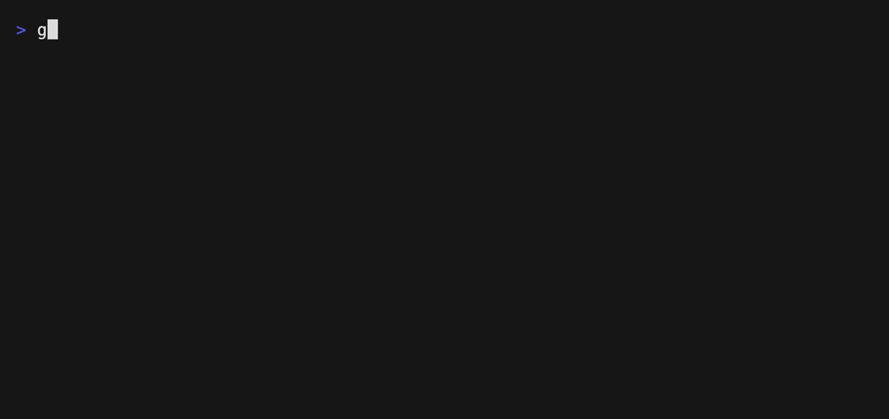

# STE100

Checks whether a markdown document follows ASD-STE100 Simplified Technical English.



- `rules/ste100.md` — the rule.
- `doc.md` — a document that violates the rule.

Set an API key, then run from the repository root:

```sh
export OPENCODE_API_KEY=...
gallant --provider opencode --model jev-1.13-free \
  --rules examples/ste100/rules examples/ste100/doc.md
```

The document is evaluated by a model, so the API key is required.

Re-record the demo GIF with [VHS](https://github.com/charmbracelet/vhs):

```sh
OPENCODE_API_KEY=... vhs examples/ste100/vhs/demo.tape
```
