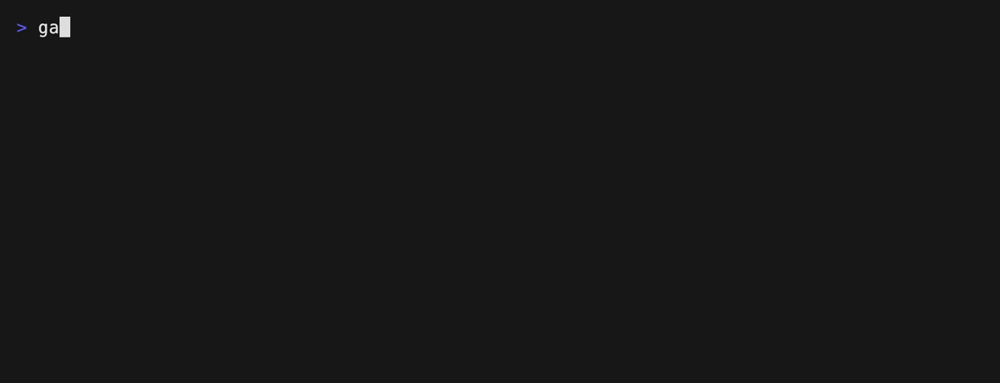

# Violation conditions

A **choice** or **score** rule can state which results make a violation. gallant
then reports a verdict instead of leaving the probabilities to the reader. This
example uses a choice rule over two Go files: one with vague names, one with
clear names.



- `rules/naming.md` — the rule, with a `violation` block.
- `sample.go` — names that are mostly filler, so the rule fails.
- `clean.go` — names that say what they mean, so the rule passes.

Set an API key, then run from the repository root:

```sh
export OPENCODE_API_KEY=...
gallant --provider opencode --model jev-1.13 \
  --rules examples/violation/rules examples/violation/sample.go
```

The rule declares:

```yaml
type: choice
criteria:
  clear: "Names say what a value holds or what a function does."
  mixed: "Some names are clear, and some are filler."
  vague: "Names are mostly filler such as data, process, handle, or doStuff."
violation:
  if:
    vague: 0.5
```

`if` lists the results that fail the rule, each with the probability above which
it fires. The rule fails when some `if` result is above its threshold, and the
verdict line comes before the outcomes the model weighed:

```
examples/violation/sample.go naming.md choice fail (vague 0.84 > 0.5)
examples/violation/sample.go naming.md choice 84% vague
examples/violation/sample.go naming.md choice 16% mixed
examples/violation/sample.go naming.md choice 0% clear
```

A passing rule is hidden, like a passing noul. Add `--include-passing` to see it:

```sh
gallant --provider opencode --model jev-1.13 --include-passing \
  --rules examples/violation/rules examples/violation/clean.go
```

```
examples/violation/clean.go naming.md choice pass (no if result above its threshold)
examples/violation/clean.go naming.md choice 94% clear
examples/violation/clean.go naming.md choice 6% mixed
examples/violation/clean.go naming.md choice 0% vague
```

A rule can also list results that cancel a violation under `unless`. Because the
outcomes of one choice are alternatives, an `unless` result is only reachable
when it is not also an `if` result and the two thresholds are low enough to be
met together, so `unless` is a safety valve rather than the usual way to write a
rule. See the [comments example](../comments) for a choice rule and the
[readability example](../readability) for a score rule, both of which declare a
violation condition.

The file is evaluated by a model, so the API key is required. See the
[JSON output example](../json) for the machine-readable shape of a verdict.

Re-record the demo GIF with [VHS](https://github.com/charmbracelet/vhs):

```sh
OPENCODE_API_KEY=... vhs examples/violation/.vhs/demo.tape
```
